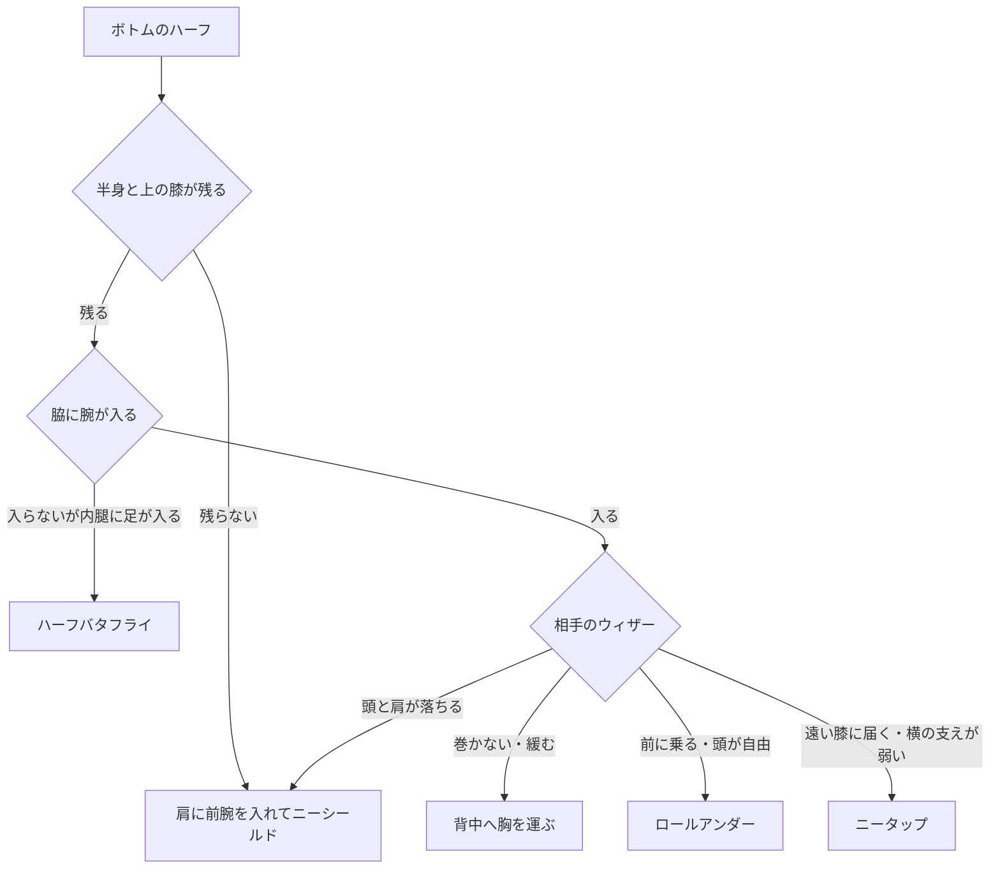
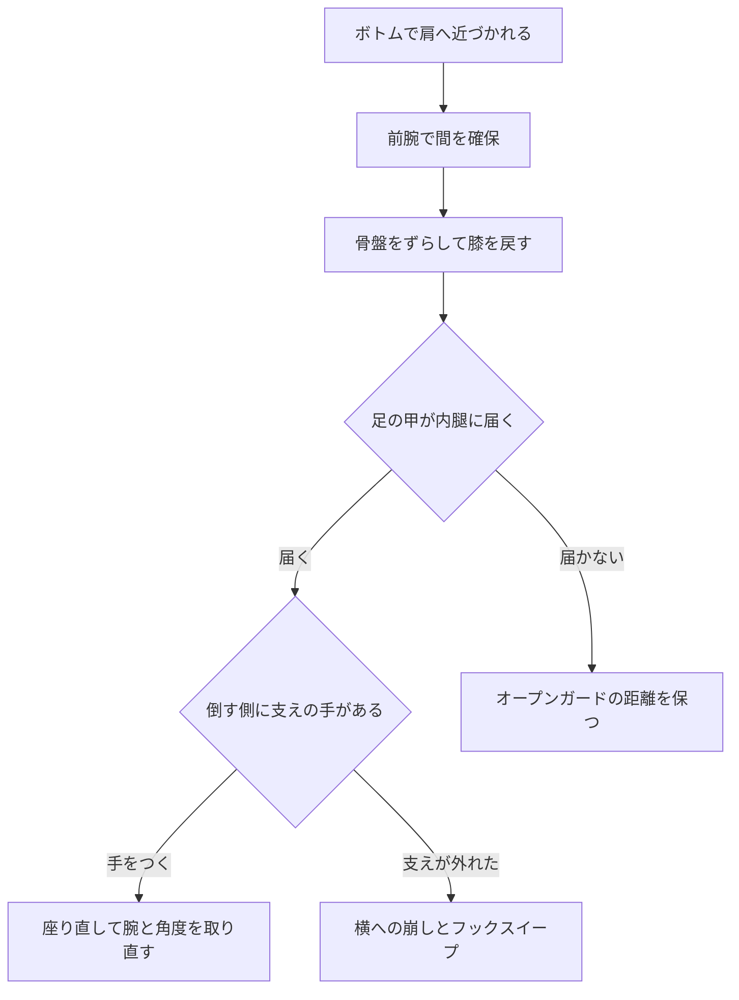
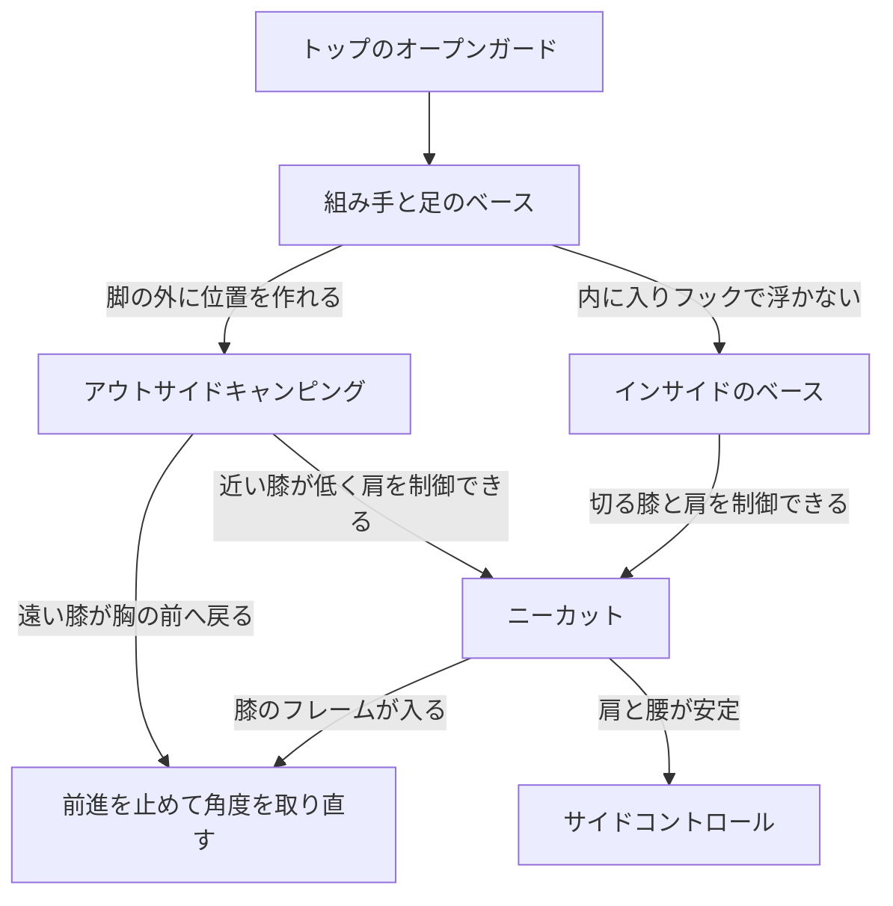
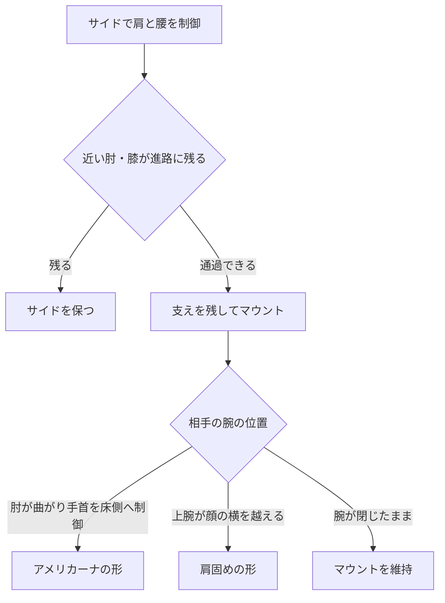

# 柔術の技術フロー

開始ポジションと相手の反応を図に示す。技術IDと根拠は[技術データ](../knowledge/techniques.json)に記録。

## ボトムのハーフガード

## ボトムのガード保持とバタフライ

## トップの入り口からパス

米倉式のファーサイド脚の固定とJポイントの手順は確認待ち。[教材分析](materials-review.md)

## サイドトップからマウント

## 道着のオープンガードと近い距離

| 開始 | 反応 | 次の一手 |
| --- | --- | --- |
| ボトム・スパイダー | 上体が高く脚が近い | 袖と足裏を保って踏み直せる脚を減らす |
| ボトム・スパイダー | 脚を引いて前傾 | 脚を追わず腕と肩を確認。片腕だけ内側なら三角 |
| ボトム・ラッソー | 肘を引かれ巻きが浅い | 膝を戻し、上腕に足裏が届けばスパイダー |
| ボトム・デラヒーバ | 膝を回されフックが外れる | 膝を引き新しい接点でオープンガード |
| ボトム・デラヒーバ | 腰が低く背中側に接点を持てる | 首に荷重しない範囲でベリンボロか背中への移行 |
| ボトム・シングルX | 遠い脚にも接点を作れる | 両脚に別の接点がある通常X |
| ボトム・クローズド | 腰を引いて上体が起きる | 手の支えを見てヒップバンプ |
| ボトム・ヒップバンプ | 倒す方向の手をつく | 手首と肘に届く条件でキムラ |
