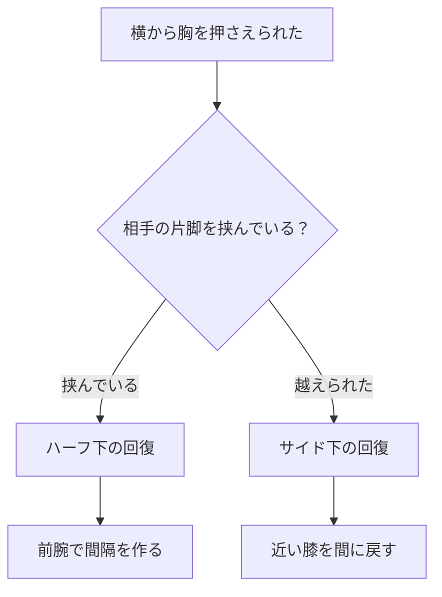
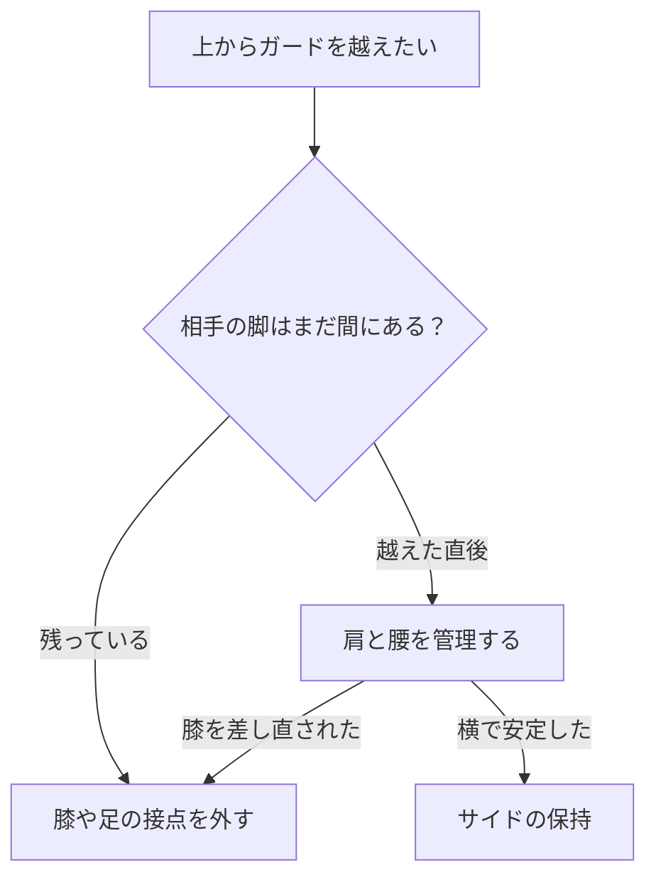

# 柔術の技名・状況判断の調査と検証

調査日 2026-11-17（日本時間）。対象はRRTらんじぇる先生AIの未経験者・白帯・青帯向け回答。更新前の公開コミットは `3d3bb02387addd62fa126e81448b018effa2a8cd`。アプリの知識版は3.0。

## 既存データの棚卸し

| 分野 | 更新前の収録・不足 | 3.0で収録・拡張した場面 |
| --- | --- | --- |
| 主要ポジション | ガード各種、サイドやバックへの移行、一般知識にマウント・タートル。横から胴に膝を置く形の項目が不足 | ニーオンベリーの上下、サイドの保持、マウントとタートルの説明を追加・更新。元のガードの名前と身体配置を照合 |
| パスと保持 | ニーカット、レッグドラッグ、トップハーフ、キャンピングあり。外を回るパスと担ぐパスの区別、越えた直後の固定が不足 | トレアンド、オーバーアンダー、両脚担ぎのスタック、各パスの早期防御。膝が戻る前と戻った後を判定 |
| スイープ | バタフライ、フラワー、シザー、ヒップバンプ、ドッグファイトあり | ジョンウェインの上下、ニーリーバーなどの別名。足甲や相手の手つきの条件からバタフライ系を検索 |
| ピンとエスケープ | サイドの下、サイドからマウント、一般知識の回復あり | ウパと肘膝での回復、エビとブリッジ。片脚が残っている場合はハーフ、完全に越えられた場合はサイドへ絞る |
| 関節技・絞め技 | 腕十字、キムラ、三角、アメリカーナ、肩固めあり。受け手と首周りの選択肢が不足 | 既存5技の初期防御と、裸絞め、送り襟絞め、ギロチン、ストレートフットロックの攻守。首への腕が前か背後か判別できないときに一問で確認 |
| 立ち技 | ルールと安全の一般知識あり | 片脚・両脚のタックルと受け方、スプロール、出足払と送足払。動く足と体重移動を見分ける |
| 固有の呼び方 | コヨーテ、アウトサイド／インサイドキャンピングあり。Jポイントの詳細は保留 | ワルジンスキのバタフライ、米倉選手の外側パスの公開文の範囲、キムラトラップ、RRT用サイドから肩の攻防。Jポイントとワルジンスキの教則は公開目次の範囲で案内 |

技術記録は41件から81件。新規40件の内訳は、一般技・身体操作・攻守の場面36件、選手や指導者の使い方・RRTの練習連係4件。既存技の別名と状況の検索も拡張した。一般知識は55件から56件で、競技ルールの改定を1件追加した。技術の出典台帳は42件から89件。公開本文・公式資料・目次・動画に付随する記事を、各行の確認範囲つきで登録した。名称や競技間の用語を説明する4件は技術記録81件の外数。

## 調査した資料と採用した範囲

| 資料 | 確認した箇所と使い方 |
| --- | --- |
| トライフォース公式 | 白帯・青帯のベーシックの構成と、受け身・エビを含む扱い。会員向けレッスンは公開名の照合に使った。[基礎カリキュラム](https://triforce-online.com/contents/category/basic-en) |
| カルペディエム青山と石川祐樹 | 青山道場のクラス別の対象と練習形式を同支部に限って照合。石川の設立経緯は既存の指導方針項目に対応。個々の技の動作は公開技術文献を参照した。[青山のクラス案内](https://www.carpediem-aoyama.com/class-schedule)・[公式寄稿](https://www.carpediembjj.com/story) |
| シュラプネル柔術と金古一朗 | 公式の道場案内と、既存の金古取材記録の指導方針。シュラプネルオンラインの会員教材は既存目次の範囲。[公式案内](https://shrapnel-bjj.com/)・[公開取材](https://myfight.style/kaneko01) |
| Grapplearts、Gracie University、Open BJJ | Kestingの公開本文・PDFでフレーム、マウントの2種類の回復、立ち技を照合。Gracie Universityは公開レッスンの導入、Open BJJはトレアンドと両脚担ぎの接点・反応を参照。オーバーアンダーはGurgel・Fariaを紹介する公開記事で片腕ずつの配置を照合。[マウント等のPDF](https://www.grapplearts.com/wp-content/uploads/2018/03/Roadmap-for-BJJ-1.5-1.pdf)・[立ち技](https://www.grapplearts.com/wrestling-moves-for-bjj/)・[トレアンド](https://www.open-bjj.com/transitions/torreando-pass)・[両脚担ぎ](https://www.open-bjj.com/transitions/double-under-pass)・[オーバーアンダー](https://www.grapplearts.com/how-to-do-the-over-under-pass/) |
| 柔術哲学、Let's BJJ、Lachlan Giles | ジョンウェインの開始位置、膝と腰による崩し、手をついたときの選択。Gilesの解説を紹介した公開記事は、トップ側の体勢を確認する根拠に使用。[柔術哲学](https://note.com/andy_s_rocky/n/n985421b2020b)・[Let's BJJ](https://letsbjj.com/en/news/news-20260615-guide-jordan-ab-sweep-systems/)・[Gilesの紹介記事](https://bjjfanatics.com/blogs/news/counter-a-common-half-guard-sweep) |
| Adam Wardziński | FloGrapplingの公開試合分析中のフックの回復、体重移動とシングルレッグXへの接続を参照。試合例に基づく説明。販売されているKnee Lever教則は公開の章名を確認した。[試合分析](https://www.flograppling.com/articles/13546176-how-adam-wardzinski-funnels-the-best-in-the-world-into-his-butterfly-guard)・[教則の公開目次](https://bjjfanatics.com/products/knee-lever-john-wayne-sweep-engineering-by-adam-wardzinski) |
| 米倉大貴とJozef Chen | 米倉選手の公開文で左右へ動くときの手の位置と膝の伸縮を見る考え方を確認。Chen名義の公開目次でJポイントと外側パスの関係を確認。米倉選手のJポイントの定義や、インバートされたときの本人の具体手順は確認待ち。[米倉の公開文](https://www.patreon.com/daikibjj/posts/172442284)・[Chenの公開目次](https://bjjfanatics.com/products/jpoint-camping-by-jozef-chen) |
| Method Jiu-Jitsu、Kurt Osiander・桜庭和志の公開記事 | 腕を伸ばす技、曲げたまま肩を回す技、肩で首を絞める技の見分け方と、組まれる前の守りを採用。切り返しの映像や完成後の脱出は導入の説明から外した。[アメリカーナ](https://www.methodjjtulsa.com/blog/americana-bjj-tulsa)・[肩固め](https://www.methodjjtulsa.com/blog/arm-triangle-choke-bjj-tulsa)・[腕十字](https://bjjfanatics.com/blogs/news/how-to-defend-and-escape-the-arm-bar-every-time)・[キムラ](https://bjjfanatics.com/blogs/news/fine-tuning-the-basics-the-kimura) |
| David AvellanとStephan Kesting | 4の字の組み手で腕と向きを制御し、位置移動するキムラトラップ。特定の教則全体への帰属や技の考案者は断定しない。[本人のシステム紹介](https://kimuratrap.com/about/)・[位置制御の公開解説](https://www.grapplearts.com/the-kimura-as-a-position/) |
| 国際柔道連盟とIBJJF | IJFで出足払・送足払・横四方固・肩固・送襟絞の定義を確認。柔術でのサイドや肩固めの用法を区別。IBJJFのストレートフットロックは2027-01-01施行の資料を日付・区分つきで収録した。[出足払](https://judo.ijf.org/techniques/De-ashi-harai)・[肩固](https://judo.ijf.org/techniques/Kata-gatame)・[IBJJFルール改定](https://ibjjf.com/rule-changes-2027/)・[施行日の告知](https://ibjjf.com/news/official-ibjjf-rules-update) |

早川光由、石川祐樹、金古一朗、ロジャー・グレイシー、マルセロ・ガルシア、ラクラン・ジャイルズの既存の練習・指導方針の項目は引き継いだ。RRTのサイドからの連係はアプリ内の練習例として扱い、RRTの公式カリキュラムや特定指導者の考案という扱いはしていない。元の本文や字幕は収録せず、説明は独自に書いた。新規の動画再生や視聴時刻の確認は行っていない。確認箇所と利用範囲は [技術出典台帳](../knowledge/sources.json) と [一般知識](../knowledge/general.json) を参照。

## 状況と攻守の見分け方

`recognition` は技名、攻守、上下、同時に必要な状況語、否定語、対応する反対側のIDを持つ。技術を追加する際は、姿勢や手足の配置を登録し、名前から一意に確かめられる質問と、状況だけでは足りない質問の両方を測る。`scenario_questions` は、確定に必要な一問と選択肢を持つ。タップと自由入力の続きは元の質問と照合する。

明確な場面は登録文をサーバーで返す。曖昧な自由記述のみGeminiに項目IDと場面の候補を送り、返ったIDと反応を検査する。Geminiが使えない場合にも登録文か確認質問を返す。AIコーチ内の回答はテキストと聞き返しの選択肢。既存の無料動画8件の一覧と技別検索は専用の動画タブから利用できる。既存認証が必要で、動画検索はGeminiを使用しない。

## 更新前後の検証

同じ177問を更新前・更新後の `resolveRequest` に入力した。判定は期待する知識ID、必要な説明や選択肢、関係のない手順や出典を含めないこと、対象ケースでの反応ID。資料不足時の案内も期待値に含む。関連性と適用範囲を対象にした自動回帰比較で、専門家による実技採点や未知の質問すべてへの正答率ではない。

| 質問の形式 | 件数 | 更新前の合格 | 更新後の合格 |
| --- | ---: | ---: | ---: |
| 正式名・一般的な技名 | 43 | 9 | 43 |
| 別名・略称・英語 | 43 | 18 | 43 |
| 技名なしの場面説明 | 43 | 2 | 43 |
| 上下・受け手の区別、否定、技の比較、範囲、規則、聞き返し | 48 | 5 | 48 |
| 合計 | 177 | 34 | 177 |

同じ177問でGeminiに送るための選択リクエストが生成された件数は旧版135件、3.0は0件。実際にGeminiへ送った件数ではない。全体のテストは360件合格。別のテストで、話題を保ったまま攻守を切り替える質問、タップと入力の両方での聞き返し、未知の反応IDの拒否を確認した。HTTPテストでは模擬Geminiの成功・429・503・不正ID、試用認証と3種類の専用リンク経路、動画タブ用データの独立を検証した。認証用の値はテスト時に生成した。

| 質問例 | 3.0の判定 |
| --- | --- |
| 横から胸を押さえられて、ひじが抜けない | 片脚を挟んでいるかを一つ聞き、ハーフ下かサイド下へ絞る |
| ニースライスって何？ → 相手にそれをされたときは？ | ニーカットの概要から、下で膝を戻す防御へ切り替える |
| 上から相手の脚をまだ越えていない | 肩と腰の固定に移る前に、どの脚が間に残っているかを見る |
| 相手に首に腕を回された | 相手が正面か背後かを一つ聞く |
| 米倉選手のJポイントの手の位置 | 公開目次で確認できた名称を伝え、本人の手順は確認待ちと明示する |

[質問と判定条件](../test/technique-intents.json)・[更新前後の全回答](technique-answer-comparison.jsonl)

再実行する場合は、更新前のリポジトリを別のディレクトリへ展開し、カレントディレクトリの新版で `node scripts/compare_technique_answers.cjs <旧版のパス>` を実行する。通常の更新時には `npm run validate:knowledge` と `npm test` を実行する。

## 未確認事項と再開箇所

1. 米倉選手のJポイント、外側から相手がインバートしたときの具体的な運足、各会員教則の本編。次は許諾の確認と該当場面の特定から着手する。
2. ディープハーフ、モディファイドX、ダース・アナコンダ、回転系の足関節などは手順の未確認項目が残る。RRTの技術指導者による実技レビューも要確認。
3. 本番のGeminiの実効上限と、ChatGPT Workの残量は確認できなかった。実APIの呼び出しは0件。確認後に新しい言い換えを少数試す。
4. スマホのチャット・動画はローカルのHTTPとHTMLのテストまで。iPhone・Android実機でのスクロールや再生、既存の専用リンクでの本番質問は未確認。
